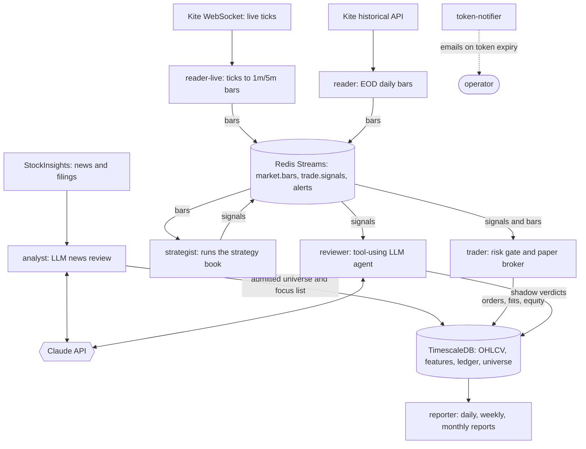

# Multi-Agent Algorithmic Trading Platform

An event-driven, multi-agent system for researching, validating and **paper-trading** equity
strategies on India's NSE. Independent Python services (data readers, an LLM-powered news
analyst, a strategist, a trader and a reporter) cooperate over a Redis Streams message bus,
with TimescaleDB as the system of record.

> **Paper trading only.** The platform places no real orders. Nothing here is financial advice.

**At a glance:** 9 containerised agent services · Redis Streams with at-least-once delivery and
idempotent consumers · live WebSocket market data · Claude-powered news analysis and a tool-using
LLM trade reviewer with evals, all under hard cost guardrails · a replay harness that runs the production binaries on history · ~11K lines of
Python · 380+ tests

---

## Architecture



Every agent is a separate long-running process built from one shared image, with its own
`restart: unless-stopped` policy. They share a core library (`trading_system.*`) and talk only
through the bus and the database. A crash in one agent never takes down another.

### The agents

| Agent | Responsibility |
|---|---|
| **reader-live** | Subscribes to the Kite WebSocket for a dynamic focus list, aggregates ticks into 1-minute and 5-minute bars, computes intraday features live, and publishes to `market.bars`. |
| **reader** | Fetches end-of-day daily bars for the Nifty 200 plus admitted names after market close, attaches features, and publishes them. |
| **analyst** | Runs a daily news and filings sweep. Candidates pass quantitative gates (liquidity, listing history) and then a **Claude** review before admission to the tradable universe. Also builds the focus list for the live reader. |
| **strategist** | Runs the validated strategy book (cross-sectional momentum, swing pullback, gap-day opening-range breakout) on incoming bars and emits `SignalEvent`s with deterministic IDs. |
| **trader** | Applies risk checks (position sizing, exposure caps), routes orders to the paper broker, and enforces stops, targets and the 15:15 intraday square-off. Writes the ledger and end-of-day equity snapshots. |
| **reviewer** | Shadow-reviews every BUY signal with a **tool-using Claude agent**: the model calls tools for the book's position, recent news, price history and sleeve exposure (all point-in-time), then submits a verdict. Verdicts are journaled, never block the trader, and fail open. `trading eval-reviews` scores them against realised forward returns. |
| **reporter** | Generates daily, weekly and monthly performance reports. Generation is data-driven: a period is reported once the next period's data exists, so the same code works live and in replay. |
| **token-notifier** | Emails an alert when the daily broker token expires, so the stack never stalls silently. |
| **backtester** | Forward-tests a strategy on the live bar stream (paper-test harness). |
| **replayer** | Re-publishes stored history session by session for the replay harness (see below). |

---

## Key design decisions

**At-least-once delivery + idempotency = effectively-once.** Consumers use Redis Streams
consumer groups and `XACK` only after processing. A crash leaves the message pending, and it is
replayed on restart. Duplicate side effects are prevented by deterministic signal IDs
(a hash of strategy, symbol, bar time and side) and `ON CONFLICT` upserts in the ledger.

**Redis Streams, behind an interface.** With ~200 symbols on one host, Kafka's partitioned
scale-out isn't needed, and Redis was already a dependency for token caching and budgets. The bus
is a `BarBus`/`SignalBus` protocol, so a Kafka adapter could be swapped in without touching the
agents.

**Crash-only agents.** All state lives in Postgres or Redis. On startup every agent runs a
catch-up cycle for anything it missed, so recovery and a normal start are the same code path.
A scheduler watchdog force-restarts any agent whose APScheduler job stops advancing (seen in
practice after host sleep/resume), and heartbeats tell a quiet agent apart from a stuck one.

**LLM in the loop, with guardrails.** The LLM only makes the judgment call that rules can't:
"is this news-driven name worth adding to the universe?" Cheap deterministic gates run first.
The review **fails closed**: any API error, timeout or malformed JSON means "don't admit". A
Redis-backed daily request budget and a hard monthly USD spend cap (computed from token
`usage`, with an alert threshold) bound the cost. A typical review costs about $0.0007.

**A tool-using agent, evaluated against outcomes.** The reviewer runs a bounded manual
tool-use loop (max 6 turns) over strict-schema tools and ends by calling `submit_verdict`.
Every turn passes the monthly spend precheck and records its cost. All tool data is filtered
to the signal's timestamp, so verdicts produced in replay are honest. The eval harness labels
each verdict with the forward return over N bars and reports veto precision, loser recall
and the return lift from following the reviewer. A deterministic rules reviewer is the
baseline the LLM has to beat.

**Paper == backtest, proven by a test.** `tests/test_paper_equivalence.py` feeds the same bars
through the batch backtest engine and through the live strategist → bus → trader → paper broker
path, and asserts the trades and equity match exactly. Paper trading isn't a separate, untested
code path.

**A replay harness that runs the production binaries.** The same strategist, trader and
reporter containers run against an isolated database clone and Redis DB (`NAMESPACE=replay`,
which the replayer enforces). A full quarter (64 sessions, 12K+ bars) replays end to end in
under 5 minutes, which tests serialization, consumer groups, the ledger and report triggers
together.

**Gap-aware, idempotent ingestion.** Before calling the broker API, ingestion compares stored
bar counts with the NSE trading calendar and fetches only the missing day ranges. A fully covered
range makes zero API calls. The API client is rate-limited and retries with jittered exponential
backoff, and raw responses are archived as Parquet before any transformation.

---

## Strategy research

The trading logic was validated before any automation was built on it:

- Event-driven backtest engine with fees, slippage, position sizing and exposure caps; no
  look-ahead (features are point-in-time).
- Walk-forward and rolling-window validation, plus a held-out out-of-sample period.
- Nine strategies researched. Several were rejected with evidence (for example, plain intraday
  VWAP reversion can't clear transaction costs). The locked book combines cross-sectional
  momentum (30%) and swing pullback (70%) over a 200-stock universe.

| Locked book, 2023–25 backtest | |
|---|---|
| CAGR | 16.6% |
| Sharpe ratio | 1.56 |
| Max drawdown | −12.3% |
| Profit factor | 2.21 |

The book is built for risk-adjusted return and drawdown control, not to beat buy-and-hold in a
strong bull market. Past and backtested performance does not predict future results.

---

## Tech stack

**Language:** Python 3.11+ · **Messaging:** Redis Streams · **Storage:** TimescaleDB
(PostgreSQL), Alembic migrations, Parquet raw archive · **Market data:** Zerodha Kite Connect
(REST + WebSocket) · **LLM:** Anthropic Claude API · **News:** StockInsights · **Data:** pandas,
NumPy, pandas-market-calendars · **Ops:** Docker Compose, APScheduler, structlog (JSON logs),
SMTP alerts · **Quality:** pytest (+ fakeredis), ruff, mypy

---

## Repository layout

```
src/trading_system/
├── agents/        reader · reader-live · analyst · strategist · trader · reporter
│                  reviewer · token_notifier · backtester · replayer · heartbeat · watchdog
├── bus/           Redis Streams bus: protocols, serde, signal events
├── data/          Kite auth/client, ingestion, cleaning, storage, screener, news client
├── features/      Technical + intraday features, versioned feature store
├── strategy/      9 strategies + registry + multi-strategy book
├── backtest/      Event-driven engine (batch and incremental feed)
├── risk/          Position sizing, exposure caps, stop rules
├── execution/     Paper broker, fee model, Postgres ledger
├── portfolio/     Backtest + live portfolio state
├── analytics/     Metrics, walk-forward, sweeps, allocation, reports
├── llm/           LLM protocol, Anthropic clients, signal-review agent loop, mocks
├── net/           Rate limits, daily budgets, monthly spend cap, mailer
├── replay/        Deterministic point-in-time bar replay
└── cli.py         `trading` CLI
tests/             380+ tests (unit, equivalence, agent lifecycle)
db/                Schema + Alembic migrations
```

---

## Getting started

**Prerequisites:** Python 3.11+, Docker, and a Zerodha Kite Connect app with the historical
data add-on.

```bash
python -m venv .venv && source .venv/bin/activate
pip install -e ".[dev]"
cp .env.example .env            # fill in Kite keys; optional: ANTHROPIC / STOCKINSIGHTS / SMTP
docker compose up -d timescaledb redis
trading auth                    # Kite token expires daily; run each morning
trading sync-instruments
trading ingest --interval day --from 2023-01-01 --to 2025-12-31
```

**Research:**

```bash
trading backtest --strategy swing_pullback --feature-version v3 --from 2023-01-01 --to 2025-12-31
trading backtest-book --sleeve xsec_momentum:0.3 --sleeve swing_pullback:0.7 \
    --feature-version v3 --from 2023-01-01 --to 2025-12-31
trading backtest-rolling --help   # rolling-window robustness
```

**Run the live paper-trading stack:**

```bash
docker compose up -d            # all agents
trading report --period daily --date 2026-07-04
```

**Replay a historic quarter through the real agents:**

```bash
scripts/replay_reset.sh
docker compose -f docker-compose.replay.yml up -d strategist trader reporter
docker compose -f docker-compose.replay.yml run --rm replayer \
    --from 2025-01-01 --to 2025-04-03 --intervals day
```

**Tests:**

```bash
pytest
```

---

## Roadmap

| Phase | Status |
|---|---|
| Data foundation: ingestion, cleaning, features, point-in-time replay | Done |
| Backtesting engine, risk and execution models, analytics | Done |
| Strategy research with rolling and out-of-sample validation | Done |
| Agent platform: Redis Streams bus, reader and backtester agents | Done |
| Live paper trading: WebSocket data, analyst, strategist, trader, reporter, replay harness | Done |
| Tool-using LLM shadow review of trade signals + eval harness | Done |
| Lessons knowledge base from reviewed outcomes; decide whether reviews gate trades | Next |
| Live order execution with kill switches | Planned |

## Known limitations

- Kite access tokens expire daily; `trading auth` is a manual morning step (the token-notifier
  emails when it lapses).
- OHLCV is stored unadjusted for corporate actions; a crash-quarantine rule guards momentum
  ranking against demerger price drops.
- Pre-2020 history for the 200-stock universe has survivorship bias, so deep-history checks use
  the 50-stock set.
